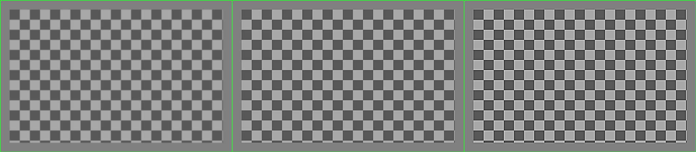

# Фильтр повышения контрастности

### Вход
---
```*.exe input.bmp output.bmp value```  

```*.exe``` - исполняемый файл программы  
```input.bmp``` - входное изображение  
```output.bmp``` - выходное изображение  
```value``` - значение из множества {4,8} - количество соседей

### Описание
---
Код обеспечивает выполнение сглаживания исходного изображения при помощи фильтра улучшения контрастности

1) матрица с 4 соседями
```math
\left(\begin{array}{ccc}0 & -1 & 0 \\ -1 & 5 & -1 \\ 0 & -1 & 0\end{array}\right)
```
  
2) матрица с 8 соседями
```math  
\left(\begin{array}{ccc}-1 & -1 & -1 \\ -1 & 9 & -1 \\ -1 & -1 & -1\end{array}\right)
```  

### Идея алгоритма
---
Составляется массив исходных пикселей изображения. Граничные пиксели - те, что имеют не полный набор соседей, остаются без изменений. К остальным пикселям применяется одна из матриц в соответствии с формулой 

```math
\left(\begin{array}{ccc}a_{11} & a_{12} & a_{13} \\ a_{21} & a_{22} & a_{23} \\ a_{31} & a_{32} & a_{33}\end{array}\right) \times \left(\begin{array}{ccc}b_{11} & b_{12} & b_{13} \\ b_{21} & b_{22} & b_{23} \\ b_{31} & b_{32} & b_{33}\end{array}\right) = \left(\begin{array}{ccc} a_{11} b_{11} & a_{12} b_{12} & a_{13} b_{13} \\ a_{21} b_{21} & a_{22} b_{22} & a_{23} b_{23} \\ a_{31} b_{31} & a_{32} b_{32} & a_{33} b_{33}\end{array}\right)
```

Так как каждый пиксель имеет 3 параметра цвета

```cpp
struct Pixel {
    uint8_t blue;
    uint8_t green;
    uint8_t red;
};
```

для каждого i-го элемента происходит подсчет вида

```math
\text{blue} = a_i.blue \cdot b_i.blue
```  

```math
\text{green} = a_i.green \cdot b_i.green
```  

```math
\text{red} = a_i.red \cdot b_i.red
```  

Но значение blue, green, red ограничиваются диапазоном [0, 255], поэтому после подсчета значения, меньшие чем 0, приравниваются к нулю, а значения, большие чем 255, приравниваются к 255

### Примеры
---

<p align="center">
  
</p>

<p align="center">
  
</p>
